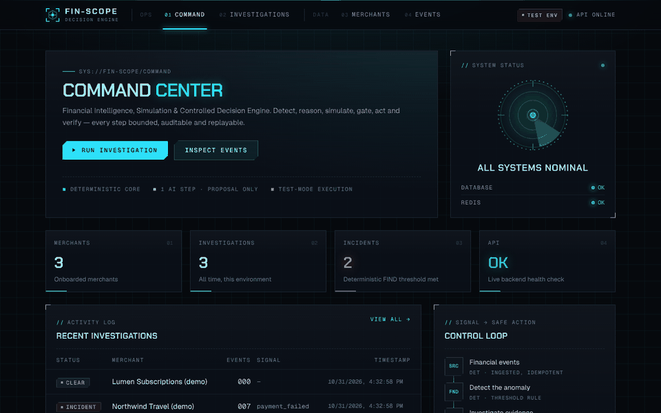
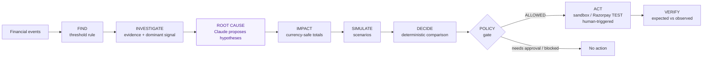
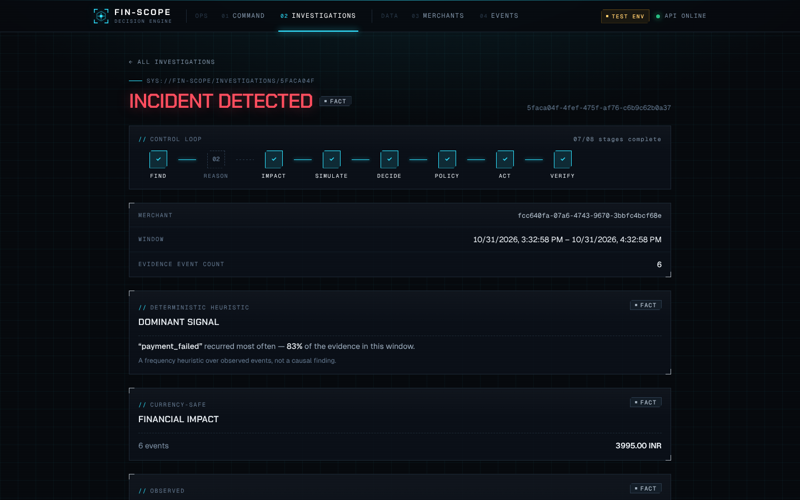
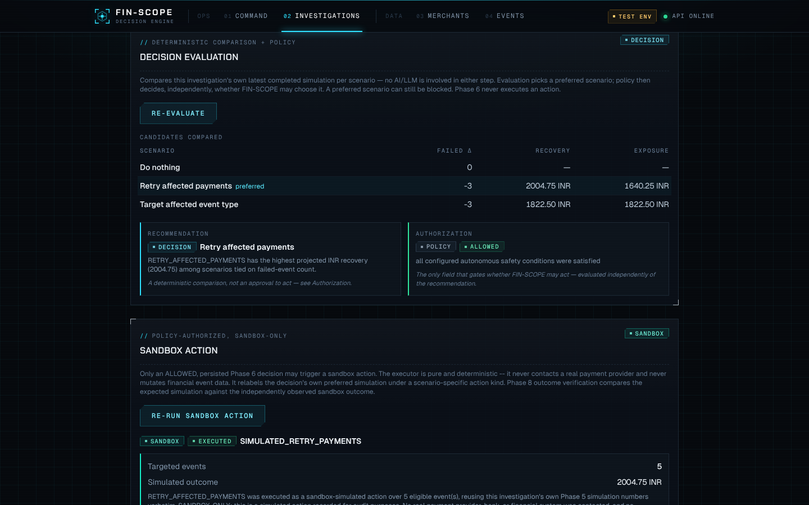

# FIN-SCOPE

**An AI-assisted incident engine for payments that detects a problem, explains it, simulates the fix, and acts only when a deterministic policy allows it.**

[](https://github.com/indhuja-elumalai/fin-scope/actions/workflows/ci.yml)

**Live demo:** [fin-scope-tawny.vercel.app](https://fin-scope-tawny.vercel.app) &nbsp;·&nbsp;
**API docs (Swagger):** [fin-scope-api.onrender.com/docs](https://fin-scope-api.onrender.com/docs) &nbsp;·&nbsp;
**Architecture:** [docs/ARCHITECTURE.md](docs/ARCHITECTURE.md)

> The API runs on Render's free tier, so the first request after a quiet period can take 30–60 seconds while it wakes up.



## The core loop



One step uses AI. Everything else is deterministic, versioned code, and every step is persisted with an audit trail.

| Investigation | Decision and policy gate |
| --- | --- |
|  |  |

## Why it's interesting

- **AI proposes, code decides.** Claude only suggests ranked root-cause hypotheses, and every hypothesis must cite real evidence IDs or the whole response is rejected. A versioned policy engine, not the model, decides whether anything may happen.
- **Money is handled carefully.** Amounts are `Decimal`, totals are never mixed across currencies, unknown amounts are counted rather than treated as zero, and event ingestion is idempotent.
- **Actions are bounded and checked afterwards.** Actions run in a sandbox or against Razorpay's TEST API, only when policy returns ALLOWED and a person clicks. Each outcome is then compared with its projection, so a mismatch is reported instead of hidden.

## Tech stack

| Layer | Tools |
| --- | --- |
| Web | Next.js 16 (App Router), React 19, TypeScript, Tailwind CSS 4 |
| API | Python 3.13, FastAPI, Pydantic v2, SQLAlchemy 2, Alembic (11 migrations) |
| Data | PostgreSQL, Redis |
| AI | Claude via the Anthropic Messages API, behind a provider interface |
| Payments | Razorpay TEST mode: orders and signed webhooks |
| Quality | pytest (352 tests), ruff, mypy, ESLint, GitHub Actions |
| Hosting | Vercel (web), Render (API, Docker), Neon (Postgres), Upstash (Redis) |

## Quick start

Requires Python 3.11+ (CI uses 3.13), Node 22 and Docker.

```bash
cp .env.example .env                     # set API_KEY to any long random string
make infra-up                            # Postgres + Redis via docker compose

cd apps/api
python3 -m venv .venv && source .venv/bin/activate
pip install -r requirements-dev.txt
alembic upgrade head
python scripts/seed_demo.py              # demo merchants, events and a full investigation
uvicorn app.main:app --reload --port 8000

# in another terminal
cd apps/web
cp .env.local.example .env.local         # set API_KEY to the same value as the API
npm install && npm run dev               # http://localhost:3000
```

Without `ANTHROPIC_API_KEY` the reasoning step reports itself as unavailable. Without Razorpay TEST keys, Razorpay actions are refused and recorded. Everything else works offline.

Tests: `make test` (backend) and `make lint`. Deployment: [docs/DEPLOYMENT.md](docs/DEPLOYMENT.md).

## Repository layout

```
apps/api      FastAPI service: domain logic, routers, models, migrations, tests
apps/web      Next.js app; route handlers proxy to the API with a server-only key
docs/         Architecture and build history, deployment guide, screenshots
infra/        Local docker-compose for Postgres and Redis
scripts/      Phase-by-phase verification scripts
```
